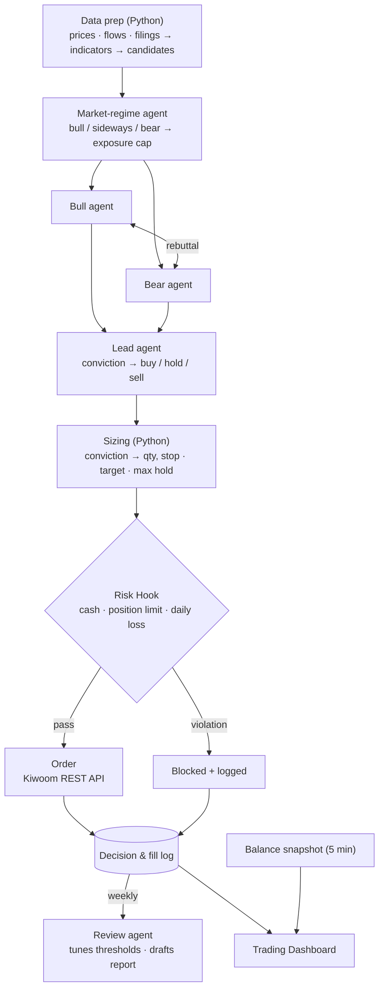

<div align="center">

# UOStock AI Trader

**An automated trading system where Claude Code agents argue, and rules decide.**

Team *Hynix 298F* · 2026 UOStock AI Auto-Trading Mock Investment Competition (Univ. of Seoul)

[**Live Dashboard →**](https://isopink.github.io/uostock-ai-trader/) · [한국어](README.md)


<sub>Screenshot shows sample data. During the competition (Nov 2 – 27, 2026) the live account balance refreshes every 5 minutes.</sub>

</div>

## At a glance

| | |
|---|---|
| **Competition** | 4-week KOSPI/KOSDAQ mock trading · ₩50M starting capital |
| **Rule** | The AI agent must make every decision and place every order; manual orders or human approval are banned |
| **Approach** | LLMs debate and score conviction; code sizes positions, enforces risk limits and can veto any order |
| **Result** | 🏁 To be updated after the competition (Nov 29, 2026) |

## Why this design

Handing an LLM the whole trading loop fails in two ways: it can misread numbers and trade on them, and a prompt like "always stop out" is a request, not a guarantee.
So the core principle is **"agents propose, rules decide."** Indicators are computed in Python and passed as summaries; risk limits are enforced outside the agent by a Claude Code **Hook** that runs right before the order tool and cannot be bypassed.

## Architecture



## Dashboard

- Live return vs KOSPI with a market-regime strip
- Conviction vs realized return scatter — did the agent's confidence mean anything?
- Trade timeline with each trade's bull case, bear case and final call on hover/tap
- Orders blocked by the risk Hook, token usage, weekly review suggestions
- Anonymous comment board (no login, flood-protected)

**Security** — Kiwoom keys live only in the `.env` of the PC that polls the balance; the website only ever sees numbers. Snapshots are written through a secret-checked Postgres function; visitors are read-only.

## Stack

Claude Code (sub-agents, Hooks, headless) · Kiwoom REST API · pykrx · OpenDartReader · GS Quant · D3.js · Supabase (Postgres, RLS, RPC) · GitHub Pages

## Repository layout

```
docs/       dashboard served by GitHub Pages
live/       Kiwoom balance → Supabase snapshot script
supabase/   comments & snapshot tables, access rules
agent/      trading agent (in progress)
reports/    plan, weekly and final reports
assets/     README images
```

Setup guide: [`docs/DEPLOY.md`](docs/DEPLOY.md) (Korean)

## Team

**Hynix 298F** — Seokmin Lee · Munhwa Park

<div align="center"><sub>Designed by S.Lee · For a mock-trading competition only. Not investment advice.</sub></div>
