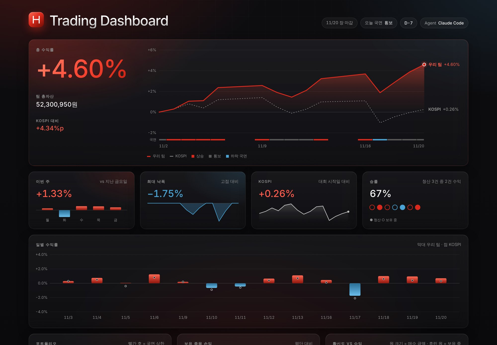
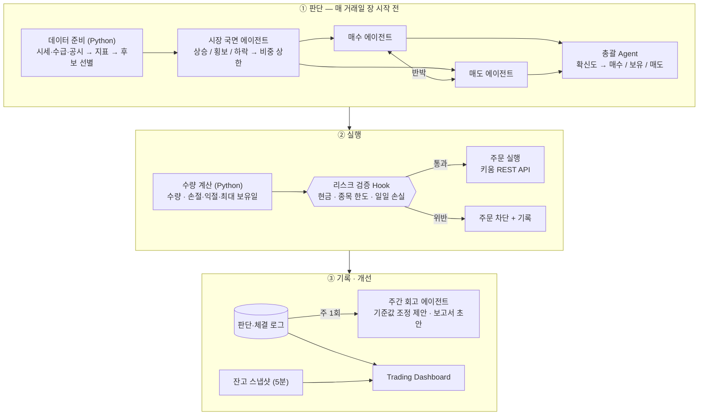
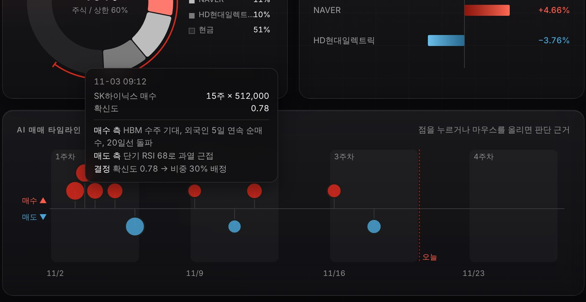
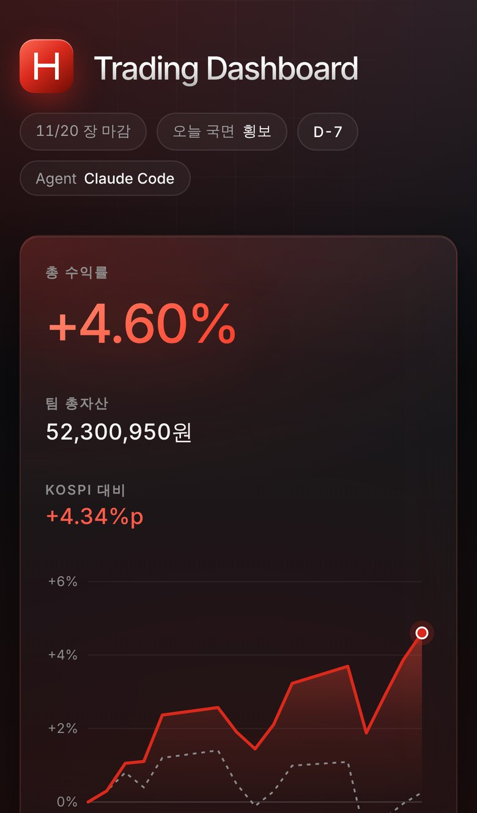

<div align="center">

# UOStock AI Trader

**Claude Code 멀티 에이전트가 판단하고, 규칙이 결정하는 자동매매 시스템**

2026 나비스트 UOStock AI 자동매매 모의주식투자대회 · 팀 「하이닉스 298층 주민」

[**Live Dashboard →**](https://isopink.github.io/hynix-298f/?v=3) · [English](README.md)




<sub>스크린샷은 샘플 데이터입니다. 대회 기간(2026.11.02 – 11.27)에는 실제 계좌 잔고가 5분마다 반영됩니다.</sub>

</div>

---

## 한눈에 보기

| | |
|---|---|
| **대회** | 국내 주식 모의투자 4주 (2026.11.02 – 11.27) · 초기 자산 5,000만 원 |
| **규칙** | AI 에이전트가 투자 판단과 주문을 **자동으로** 수행 (사람의 수동 주문·주문 승인 금지) |
| **접근** | LLM은 근거를 토론하고 확신도를 매기는 역할만, 수량·리스크·주문 차단은 코드가 결정 |
| **결과** | 🏁 대회 종료 후 업데이트 (2026.11.29) |

## 왜 이렇게 만들었나

LLM에게 매매를 통째로 맡기면 두 가지 문제가 생깁니다.

1. **숫자 환각** — 시세나 지표를 틀리게 읽고 그대로 주문으로 이어짐
2. **통제 불가** — 프롬프트로 "손절하라"고 해도 에이전트가 따르지 않을 수 있음

그래서 이 시스템은 **"에이전트는 제안하고, 규칙이 결정한다"** 를 원칙으로 합니다.
숫자는 코드가 미리 계산해 요약만 넘기고, 리스크 한도는 에이전트 바깥(Claude Code Hook)에서 주문 직전에 강제로 검사합니다.

## 시스템 구조



| 역할 | 담당 | 하는 일 |
|---|---|---|
| 총괄 Agent | Claude Code | 매수·매도 근거 비교, 종목별 확신도 산출, 최종 결정 |
| 시장 국면 | 서브에이전트 | 지수 추세·변동성으로 국면 분류, 전체 투자 비중 상한 조정 |
| 매수 / 매도 | 서브에이전트 | 후보·보유 종목별 강세 / 약세 근거 제시, 서로 반박 |
| 주간 회고 | 서브에이전트 | 거래 기록 분석, 판단 기준값 조정 제안 (리스크 한도는 수정 불가) |
| 데이터 준비 | Python | 시세·수급·공시 수집, 지표 계산 → LLM에는 숫자 요약만 전달 |
| 수량 계산 | Python | 확신도를 주문 수량으로 변환, 손절·익절·최대 보유일 설정 |
| 리스크 검증 | Claude Code Hook | 주문 직전 한도 강제 확인, 위반 시 차단 |

### 설계 원칙

- **숫자는 코드가 계산** — 지표를 미리 계산해 요약만 넘겨 토큰을 줄이고 환각을 막음
- **후보를 먼저 좁힘** — 지표 조건으로 추린 종목만 토론
- **규칙은 에이전트 밖에서 강제** — Hook이 주문 도구 실행 직전에 검사하므로 에이전트가 우회할 수 없음
- **스스로 개선, 단 한도는 고정** — 회고 에이전트가 기준값을 조정하되 리스크 한도는 건드리지 않음
- **사람 개입 없음** — 정해진 시각에 헤드리스로 실행, 개별 주문을 사람이 승인·거절하지 않음

## Trading Dashboard

에이전트가 무엇을 근거로 샀고 팔았는지를 한 화면에서 보여주는 대시보드입니다.

<table>
<tr>
<td width="62%"></td>
<td></td>
</tr>
<tr>
<td align="center"><sub>매매 타임라인 — 점을 누르면 매수 측·매도 측 근거와 최종 결정</sub></td>
<td align="center"><sub>모바일</sub></td>
</tr>
</table>

| 기능 | 설명 |
|---|---|
| 실시간 수익률 | 장중 5분마다 키움 잔고를 조회해 Supabase로 전송, 화면은 30초마다 갱신 |
| 누적 수익률 vs KOSPI | 시장 국면(상승·횡보·하락) 띠와 함께 표시 |
| 확신도 vs 수익 | 에이전트의 확신도가 실제 수익과 맞았는지 검증 |
| 매매 타임라인 | 거래마다 에이전트 토론 내용을 툴팁으로 확인 |
| 리스크 차단 기록 | Hook이 막은 주문과 위반 규칙 |
| 토큰 사용량 | 일별 사용량과 실행 실패 |
| 익명 응원 게시판 | 로그인 없이 댓글 (도배 방지 포함) |

**보안 설계** — 키움 App Key는 잔고를 조회하는 PC의 `.env`에만 존재하고, 웹에는 숫자만 공개됩니다. 스냅샷 업로드는 비밀문구를 확인하는 DB 함수로만 가능하며, 방문자는 읽기만 할 수 있습니다.

## 기술 스택

| 영역 | 사용 |
|---|---|
| 에이전트 | Claude Code (서브에이전트 `.claude/agents/`, Hooks, 헤드리스 실행) |
| 데이터 | 키움 REST API, pykrx, OpenDartReader, 검색 MCP |
| 지표 | GS Quant (이동평균·변동성·RSI·최대 낙폭) |
| 대시보드 | HTML · CSS · D3.js (빌드 도구 없음), GitHub Pages |
| 실시간 · 게시판 | Supabase (PostgreSQL, RLS, RPC) |
| 자동 실행 | Windows 작업 스케줄러 |

## 폴더 구조

```
hynix-298f/
├── docs/                 # GitHub Pages로 배포되는 대시보드
│   ├── index.html
│   ├── config.js         # Supabase 공개 키 (anon)
│   └── data/             # 에이전트 로그 (거래·판단 근거·회고 등)
├── live/                 # 키움 잔고 → Supabase 스냅샷 스크립트
│   ├── snapshot.py
│   ├── .env.example
│   └── run_snapshot.bat
├── supabase/
│   └── schema.sql        # 게시판 · 스냅샷 테이블, 접근 권한
├── agent/                # 트레이딩 에이전트 (개발 중)
├── reports/              # 사전 계획서 · 주간 보고서 · 최종 보고서
└── assets/               # README 이미지
```

## 직접 실행하기

배포와 실시간 연결 방법은 [`docs/DEPLOY.md`](docs/DEPLOY.md)에 단계별로 정리했습니다.

```bash
# 대시보드 미리 보기
cd docs && python -m http.server 8000   # → http://localhost:8000

# 잔고 조회 확인 (키움 키 설정 후)
cd live && python snapshot.py --dry
```

## 결과와 회고

> 🏁 대회 종료 후 업데이트 예정 (2026.11.29)
>
> - 최종 수익률 · KOSPI 대비 성과 · 회전율
> - 확신도와 실제 수익의 관계
> - 리스크 Hook이 막은 주문이 결과에 준 영향
> - 잘된 판단 / 틀린 판단 사례
> - 다시 만든다면 바꿀 점

## 참고한 오픈소스

| 저장소 | 참고한 점 |
|---|---|
| [BijectiveLabs/bitra](https://github.com/BijectiveLabs/bitra) | "에이전트는 제안하고 시스템이 결정한다" 구조, 판단·거절 기록 방식 |
| [fidetolabs/qanat](https://github.com/fidetolabs/qanat) | 공시 기반 종목 선별을 에이전트가 MCP로 조회하는 구조 |
| [Kiwoom-Securities/Kiwoom-REST-API](https://github.com/Kiwoom-Securities/Kiwoom-REST-API) | 시세·잔고 조회, 모의 주문 |
| [goldmansachs/gs-quant](https://github.com/goldmansachs/gs-quant) | 지표 계산 |

## 팀

**하이닉스 298층 주민** — 이석민 · 박문화

[](https://www.instagram.com/sl2eee/)

---

<div align="center">
<sub>Designed by <a href="https://www.instagram.com/sl2eee/">S.Lee</a> · 본 프로젝트는 모의투자 대회용이며 투자 권유가 아닙니다.</sub>
</div>
