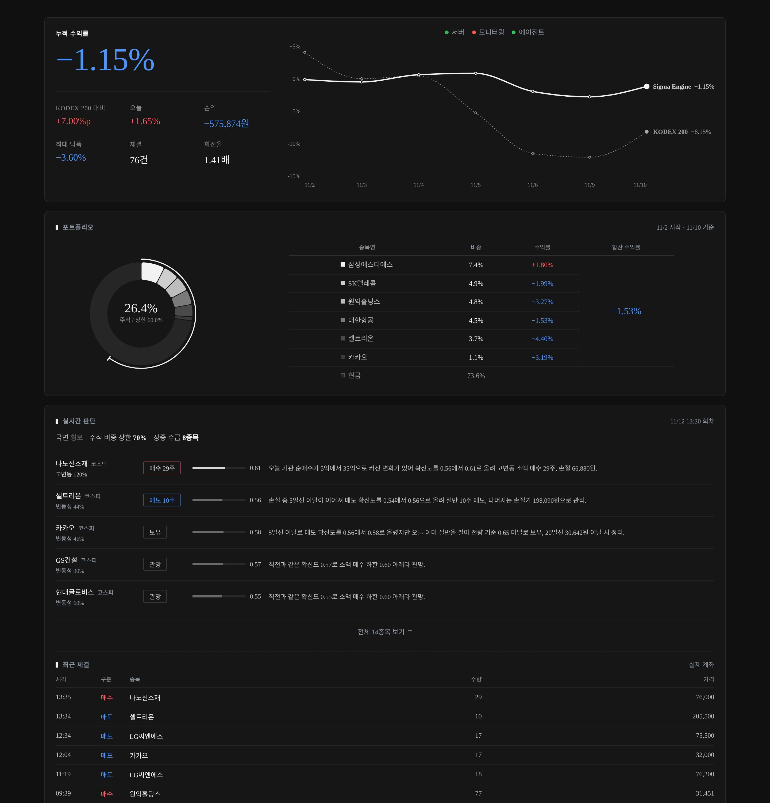
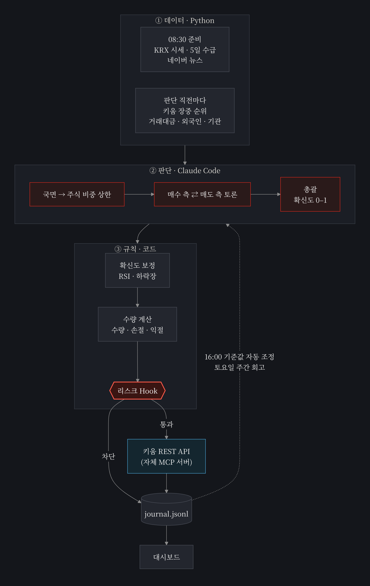
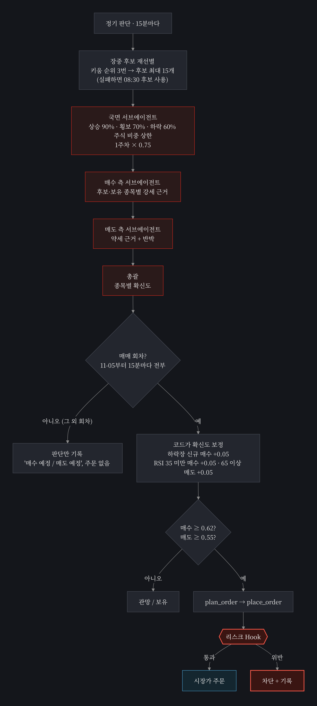
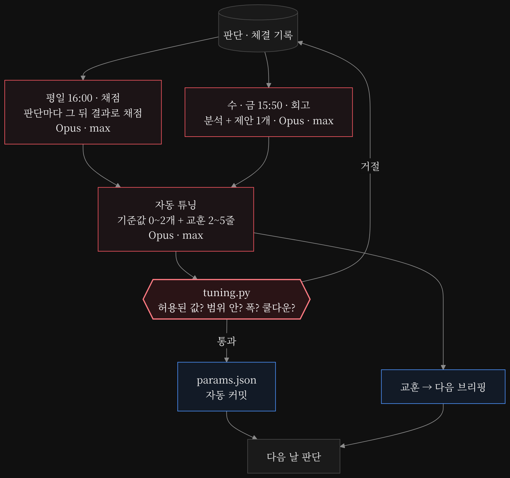
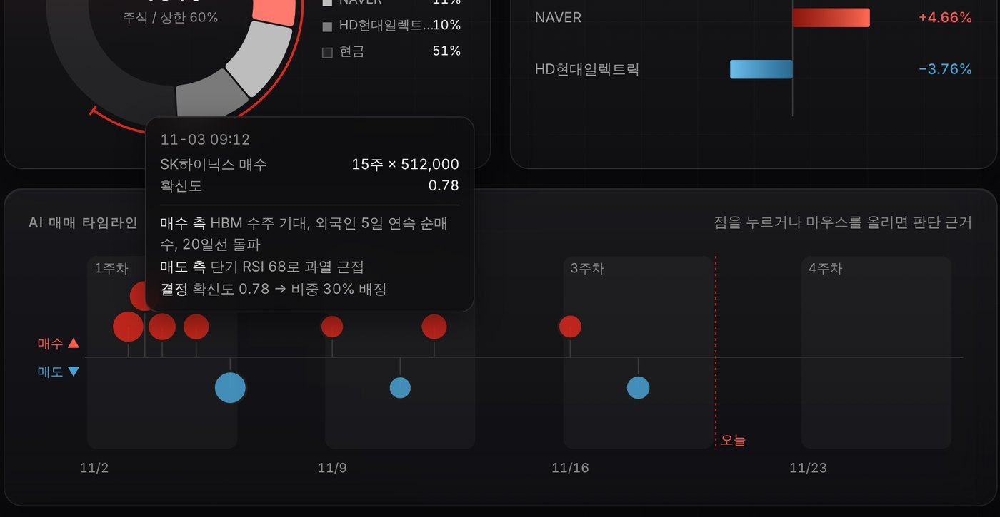
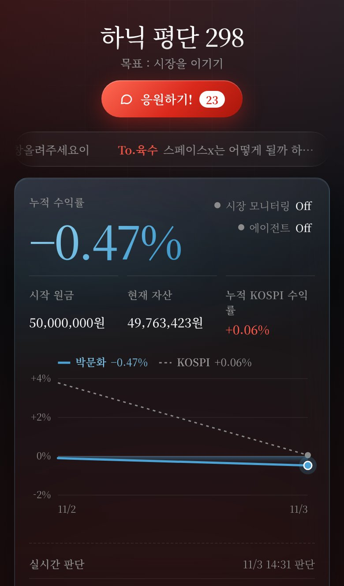

<div align="center">

# UOStock AI Trader

**Claude Code 에이전트가 토론하고, 코드가 결정한다**

2026 나비스트 UOStock AI 자동매매 모의주식투자대회 · 팀 「하이닉스 298층 주민」

[**Live Dashboard →**](https://isopink.github.io/hynix-298f/) · [English](README.md)




</div>

---

## 한눈에 보기

| | |
|---|---|
| **대회** | 국내 주식 모의투자, 2026.11.02 – 11.27 · 팀 계좌 1개 · 5,000만 원 |
| **규칙** | 판단과 주문은 AI가 직접. 사람의 수동 주문·주문 승인 금지 |
| **접근** | LLM은 토론하고 확신도만 매김. 수량은 Python이 계산하고, Hook이 주문을 막을 수 있음 |
| **주기** | 15분마다 판단하고 매번 주문 (09:30 – 15:15, 하루 24번). 그날 판 종목은 다시 사지 않음 |
| **결과** | 🏁 대회 종료 후 (2026.11.29) |

## 왜 이렇게 만들었나

LLM에게 매매를 통째로 맡기면 두 가지가 문제입니다.

1. **숫자 환각** — 가격을 잘못 읽고 그대로 주문
2. **강제력 없음** — 프롬프트의 "−7%면 손절"은 부탁일 뿐 보장이 아님

그래서 원칙은 하나입니다. **에이전트는 제안하고, 규칙이 결정한다.**

- 모델이 보는 숫자는 전부 Python이 먼저 계산합니다.
- 주문 수량은 모델이 아니라 Python이 정합니다.
- 리스크 한도는 주문 도구 직전에 실행되는 Claude Code Hook에 있습니다. 에이전트는 건너뛰지도 고치지도 못합니다.

## 동작 방식

### 전체 흐름

<p align="center"></p>

### 판단 1회

<p align="center"></p>

매도를 먼저 하고 매수는 그다음입니다. 손절·익절·최대 보유일은 감시 루프가 1분마다 확인하고, 걸리면 매도 전용 에이전트 실행을 띄웁니다. 그 주문도 감시 루프가 직접 내지 않고 에이전트와 Hook을 거칩니다.

### 역할

| 역할 | 실행 | 하는 일 |
|---|---|---|
| 총괄 | Claude Code (헤드리스) | 양측 근거 비교, 확신도 산출, MCP 도구로 주문 |
| 국면 | 서브에이전트 | 지수 추세(5·20일선)와 변동성 → 상승 / 횡보 / 하락 |
| 매수 측 / 매도 측 | 서브에이전트 | 브리핑 숫자와 뉴스만으로 종목별 찬반 토론 |
| 주간 회고 | 서브에이전트 | 기록 분석 → 주간 보고서 초안 + 기준값 조정 제안 |
| 데이터 준비 | Python | KRX 시세·수급, 네이버 뉴스 → GS Quant 지표 → 후보 선별 |
| 장중 재선별 | Python | 키움 거래대금·외국인·기관 순매수 순위 → 새 후보, 장중 RSI |
| 수량 계산 | Python | 확신도 → 종목당 5~10% (여러 종목으로 나눠 삼) → 수량. 손절 −7%, 익절 +15%, 최대 10거래일 |
| 리스크 검증 | Claude Code Hook | 모든 `place_order` 직전 실행, 하나라도 위반하면 차단 |
| 기준값 조정 | Python + 에이전트 | 매일 에이전트가 0~2개 제안, 고정 규칙 안의 것만 코드가 반영 |
| 장중 감시 | Python | 1분마다 손절·익절·보유일 → 매도 전용 실행 |
| 주문 | 자체 MCP 서버 | 키움 REST API 직접 호출 (운영진 확인 완료) |

### 리스크 한도 (대회 내내 고정)

| 규칙 | 한도 |
|---|---|
| 종목당 비중 | 총자산의 20% 이하 |
| 보유 종목 수 | 20개 이하 |
| 현금 | 총자산의 10% 이상 |
| 주문 1회 | 1,000만 원 이하 · 실행 1번에 8건 이하 |
| 추격 매수 | 오늘 +10% 이상 오른 종목은 매수 금지 |
| 일일 손실 | −3%면 그날 신규 매수 중단 |
| 누적 손실 | −10%면 주식 비중 상한 절반 |
| 주식 비중 | 국면 상한 × 주차 계수 |

에이전트는 이 값을 못 바꿉니다. 자동 조정도 판단 기준값만, [`agent/config/tuning.json`](agent/config/tuning.json)에 정한 범위 안에서만 바꿉니다.

### 스스로 조정하되, 울타리 안에서

<p align="center"></p>

반영·거절 내역은 모두 대시보드 Feedback Loop에 공개됩니다.

<sub>도식 원본: [`assets/diagrams/*.mmd`](assets/diagrams) → `node assets/diagrams/render.js` 로 다시 그림</sub>

## 하루 일정 (평일)

| 시각 | 실행 | LLM |
|---|---|---|
| 08:30 | `prep` — 계좌, KRX 데이터, 뉴스 → 브리핑 | – |
| 08:55 → | 잔고 스냅샷 1분마다 → Supabase | – |
| 08:30 – 15:20 | `monitor` — 1분마다 손절·익절·보유일 | 걸릴 때만 |
| **09:30 – 15:15, 15분마다** | `decide` — 재선별 → 토론 → **주문** (11-05부터 모든 회차가 매매) | ✓ |
| 15:45 | `close` — 오늘 자산 기록 | – |
| 16:00 | `tune` — 기준값 자동 조정 | ✓ |
| 토 10:00 | `review` — 주간 회고, 보고서 초안 | ✓ |
| 상시 | `sync` — 1분마다 push된 코드 반영, 바뀐 루프 재시작 | – |

에이전트는 계속 켜 두는 데스크톱에서 돌고, 수정은 노트북에서 합니다. push하면 1분 안에 데스크톱에 반영됩니다.

## 대시보드

에이전트가 무엇을, 왜 샀는지 한 페이지에서 봅니다.

<table>
<tr>
<td width="62%"></td>
<td></td>
</tr>
<tr>
<td align="center"><sub>PC — 거래를 누르면 매수 측·매도 측 근거와 최종 판단</sub></td>
<td align="center"><sub>폰 — 홍보용 요약 화면</sub></td>
</tr>
</table>

| 영역 | 내용 |
|---|---|
| **상단** | 대회 시작 이후 누적 수익률 vs KOSPI, 현재 자산, 에이전트 작동 여부 |
| **실시간 판단** | 최근 판단의 국면·비중 상한, 종목별 행동과 확신도 (근거는 마우스 오버·탭) |
| **실시간 KOSPI** | 1분봉 vs 전일 종가, 거래량, RSI, 투자자별 순매수 |
| **Portfolio** | 국면 상한 대비 보유 비중, 종목별 손익 (수수료·세금 반영 전/후) |
| **Record** | 이번 주, 최대 낙폭, 승률, 리스크 한도 사용률, 일별 초과수익, 수익률 캘린더 |
| **Agent Black Box** | 토론 근거가 붙은 매매 타임라인, Hook 차단, 확신도 vs 수익, 토큰 사용량, Feedback Loop, 전체 판단 로그 |
| **응원하기** | 로그인 없는 익명 게시판 (도배 방지) |

폰에서는 상단, 매수·매도 판단, 보유 손익, KOSPI, 캘린더만 보입니다. 전체 화면은 PC에서 봅니다.

**데이터 경로** — 키움 키는 데스크톱의 `.env`에만 있습니다. 웹은 두 곳에서 읽습니다. 하나는 에이전트가 push하는 `docs/data/` JSON이고, 다른 하나는 Supabase입니다. Supabase에는 잔고 스냅샷이 비밀문구를 확인하는 RPC로만 들어오고, KOSPI 1분봉(네이버)과 투자자별 수급(다음)은 `pg_cron`이 직접 수집합니다. 방문자는 읽기만 할 수 있습니다.

## 기술 스택

| 분야 | 도구 |
|---|---|
| 에이전트 | Claude Code — 헤드리스 실행, 서브에이전트, PreToolUse Hook, MCP 서버, 도구 허용 목록 (Bash / Edit / Write 금지) |
| 증권사 | 키움 REST API — 잔고 `kt00018`, 현재가 `ka10001`, 순위 `ka10032` · `ka10065`, 주문 `kt10000` · `kt10001` |
| 시장 데이터 | KRX 정보데이터시스템 (pykrx), NAVER API HUB 뉴스 검색, Supabase로 받는 네이버·다음 금융 |
| 지표 | GS Quant — 이동평균, RSI, 변동성, 최대 낙폭 |
| 대시보드 | HTML · CSS · D3.js v7, 빌드 없음, GitHub Pages |
| 실시간 | Supabase — PostgreSQL, RLS, RPC, `pg_cron`, `pg_net` |
| 스케줄 | Windows 작업 스케줄러 |

## 저장소 구조

```
hynix-298f/
├── agent/                  # 트레이딩 에이전트 → agent/README.md
│   ├── CLAUDE.md           # 총괄 에이전트 지시문
│   ├── .claude/            # 서브에이전트 (regime · bull · bear · review), 리스크 Hook, 권한
│   ├── config/             # risk_limits.json (고정) · params.json (자동 조정) · tuning.json (조정 규칙)
│   ├── src/                # data_prep · intraday · sizing · risk · broker · mcp_server
│   │                       # monitor · tuning · logger · sync
│   ├── tests/test_rules.py
│   ├── run.py              # prep / decide / exit / close / tune / review / monitor / sync
│   └── setup_tasks.ps1     # 작업 스케줄러 등록
├── docs/                   # 대시보드 (GitHub Pages)
│   ├── index.html          # 단일 파일
│   ├── config.js           # Supabase 주소 + 공개 anon 키
│   └── data/               # 실행마다 에이전트가 쓰는 JSON
├── live/snapshot.py        # 키움 잔고 + KOSPI → Supabase, 1분마다
├── supabase/               # schema.sql · kospi.sql · flow.sql · ewy.sql
├── reports/                # 계획서, 주간·최종 보고서
└── assets/                 # README 이미지
```

## 실행

배포 가이드: [`docs/DEPLOY.md`](docs/DEPLOY.md) · 에이전트 설치: [`agent/README.md`](agent/README.md)

```bash
# 대시보드 로컬 미리보기
cd docs && python -m http.server 8000          # → http://localhost:8000

# 잔고 연결 확인 (live/.env 작성 후)
cd live && python snapshot.py --dry

# 에이전트 1회 실행 (agent/.env 의 MODE=mock 이면 가상 계좌)
cd agent
.venv\Scripts\python tests\test_rules.py
.venv\Scripts\python run.py prep
.venv\Scripts\python run.py decide
```

## 결과와 회고

> 🏁 대회 종료 후 (2026.11.29)
>
> - 최종 수익률, KOSPI 대비 초과수익, 회전율
> - 확신도가 실제 수익을 예측했는가
> - 리스크 Hook이 막은 주문과 그 영향
> - 자동 조정이 무엇을 바꿨고, 도움이 됐는가
> - 다시 한다면 바꿀 것

## 참고한 저장소

| 저장소 | 가져온 것 |
|---|---|
| [BijectiveLabs/bitra](https://github.com/BijectiveLabs/bitra) | "에이전트는 제안하고 시스템이 결정한다", 판단·거절 기록 |
| [fidetolabs/qanat](https://github.com/fidetolabs/qanat) | MCP로 종목 스크리닝을 조회하는 에이전트 |
| [Kiwoom-Securities/Kiwoom-REST-API](https://github.com/Kiwoom-Securities/Kiwoom-REST-API) | 시세·잔고·순위·모의 주문 |
| [goldmansachs/gs-quant](https://github.com/goldmansachs/gs-quant) | 지표 계산 |

## 팀

**하이닉스 298층 주민** — 이석민 · 박문화

[](https://www.instagram.com/sl2eee/)

---

<div align="center">
<sub>Designed by S.Lee &amp; M.Park · 모의투자 대회용으로 만든 프로젝트입니다. 투자 권유가 아닙니다.</sub>
</div>
