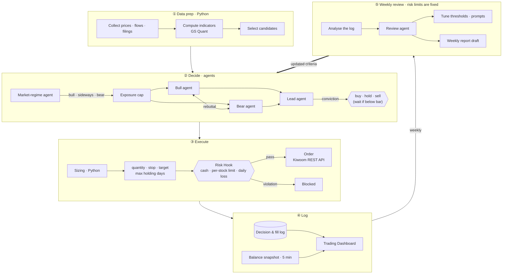

<div align="center">

# UOStock AI Trader

**An automated trading system where Claude Code agents argue, and rules decide.**

Team *Hynix 298F* · 2026 Navist UOStock AI Auto-Trading Mock Investment Competition (University of Seoul)

[**Live Dashboard →**](https://isopink.github.io/hynix-298f/?v=3) · [한국어](README.ko.md)


<sub>Screenshot shows sample data. During the competition (Nov 2 – 27, 2026) the live account balance refreshes every 5 minutes.</sub>

</div>

---

## At a glance

| | |
|---|---|
| **Competition** | 4 weeks of Korean equities mock trading (Nov 2 – 27, 2026) · ₩50M starting capital |
| **Rule** | The AI agent must make every investment decision and place every order **on its own** — manual orders and human approval of orders are banned |
| **Approach** | LLMs only debate and score conviction; code decides position size, enforces risk limits and can veto any order |
| **Result** | 🏁 To be updated after the competition (Nov 29, 2026) |

## Why this design

Handing the whole trading loop to an LLM fails in two ways:

1. **Number hallucination** — the model misreads a price or an indicator and trades on it.
2. **No real control** — "always cut losses at −7%" in a prompt is a request, not a guarantee.

So the system is built on one principle: **agents propose, rules decide.**
Indicators are computed in Python and handed to the model as short summaries, and risk limits are enforced *outside* the agent by a Claude Code Hook that runs right before the order tool fires.

## Architecture



| Role | Runs as | Responsibility |
|---|---|---|
| Lead agent | Claude Code | Weighs bull vs. bear arguments, scores conviction per stock, makes the final call |
| Market regime | Sub-agent | Classifies the market from index trend and volatility, sets the overall exposure cap |
| Bull / Bear | Sub-agents | Make the case for and against each candidate and holding, then rebut each other |
| Weekly review | Sub-agent | Analyses the trade log and proposes threshold changes (cannot touch risk limits) |
| Data prep | Python | Collects prices, flows and filings, computes indicators, passes only numeric summaries to the LLM |
| Sizing | Python | Converts conviction into order quantity; sets stop-loss, take-profit and max holding days |
| Risk check | Claude Code Hook | Enforces hard limits right before every order; blocks violations |

### Design principles

- **Code does the math** — indicators are pre-computed, which cuts tokens and removes room for hallucinated numbers.
- **Narrow first, debate second** — only stocks that pass indicator filters reach the bull/bear debate.
- **Rules live outside the agent** — the Hook runs before the order tool, so the agent can neither skip nor edit it.
- **Self-improving, with fixed guardrails** — the review agent tunes decision thresholds but never the risk limits.
- **No human in the loop** — runs headless on a schedule; nobody approves or rejects individual orders.

## Trading Dashboard

A single page that shows not just *what* the agent traded but *why*.

<table>
<tr>
<td width="62%"></td>
<td></td>
</tr>
<tr>
<td align="center"><sub>Trade timeline — tap a dot to see the bull case, bear case and final decision</sub></td>
<td align="center"><sub>Mobile</sub></td>
</tr>
</table>

| Feature | Description |
|---|---|
| Live return | Kiwoom balance polled every 5 minutes during market hours, pushed to Supabase; the page refreshes every 30 s |
| Cumulative return vs. KOSPI | Overlaid with a market-regime strip (bull · sideways · bear) |
| Conviction vs. return | Checks whether the agent's confidence actually predicted outcomes |
| Trade timeline | The agents' debate behind every trade, one tap away |
| Blocked orders | Orders stopped by the risk Hook and the rule they broke |
| Token usage | Daily usage and failed runs |
| Anonymous comment board | No login, flood-protected |

**Security** — Kiwoom API keys exist only in the `.env` of the one PC that polls the balance; the website only ever sees numbers. Snapshots can be written solely through a secret-checked Postgres function, and visitors are read-only.

## Tech stack

| Area | Tools |
|---|---|
| Agents | Claude Code — sub-agents (`.claude/agents/`), Hooks, headless mode |
| Market data | Kiwoom REST API, pykrx, OpenDartReader, search MCP |
| Indicators | GS Quant (moving averages, volatility, RSI, max drawdown) |
| Dashboard | Plain HTML · CSS · D3.js (no build step), GitHub Pages |
| Realtime & comments | Supabase (PostgreSQL, Row Level Security, RPC) |
| Scheduling | Windows Task Scheduler |

## Repository layout

```
hynix-298f/
├── docs/                 # Dashboard, served by GitHub Pages
│   ├── index.html
│   ├── config.js         # Supabase public (anon) key
│   ├── data/             # Agent logs: trades, rationale, weekly review, …
│   └── DEPLOY.md         # Setup guide (Korean)
├── live/                 # Kiwoom balance → Supabase snapshot script
│   ├── snapshot.py
│   ├── .env.example
│   └── run_snapshot.bat
├── supabase/
│   └── schema.sql        # Comments & snapshots tables, access rules
├── agent/                # Trading agent (in progress)
├── reports/              # Plan, weekly and final reports
└── assets/               # README images
```

## Running it

Step-by-step deployment and realtime setup: [`docs/DEPLOY.md`](docs/DEPLOY.md) (Korean).

```bash
# Preview the dashboard locally
cd docs && python -m http.server 8000   # → http://localhost:8000

# Check the balance connection (after filling live/.env)
cd live && python snapshot.py --dry
```

## Results & retrospective

> 🏁 To be updated after the competition (Nov 29, 2026)
>
> - Final return, excess return over KOSPI, turnover
> - How well conviction scores matched realised returns
> - How orders blocked by the risk Hook affected the outcome
> - Calls the agents got right — and wrong
> - What I would change next time

## Acknowledgements

| Repository | What I borrowed |
|---|---|
| [BijectiveLabs/bitra](https://github.com/BijectiveLabs/bitra) | "Agents propose, the system decides" architecture; logging of decisions and rejections |
| [fidetolabs/qanat](https://github.com/fidetolabs/qanat) | Agents querying filings-based stock screens through MCP |
| [Kiwoom-Securities/Kiwoom-REST-API](https://github.com/Kiwoom-Securities/Kiwoom-REST-API) | Quotes, balance and mock orders |
| [goldmansachs/gs-quant](https://github.com/goldmansachs/gs-quant) | Indicator computation |

## Team

**Hynix 298F** — Seokmin Lee · Munhwa Park

[](https://www.instagram.com/sl2eee/)

---

<div align="center">
<sub>Designed by <a href="https://www.instagram.com/sl2eee/">S.Lee</a> · Built for a mock-trading competition. Not investment advice.</sub>
</div>
