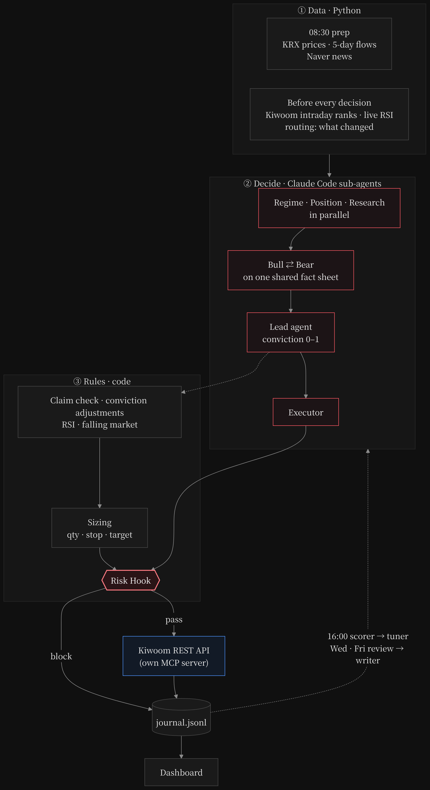
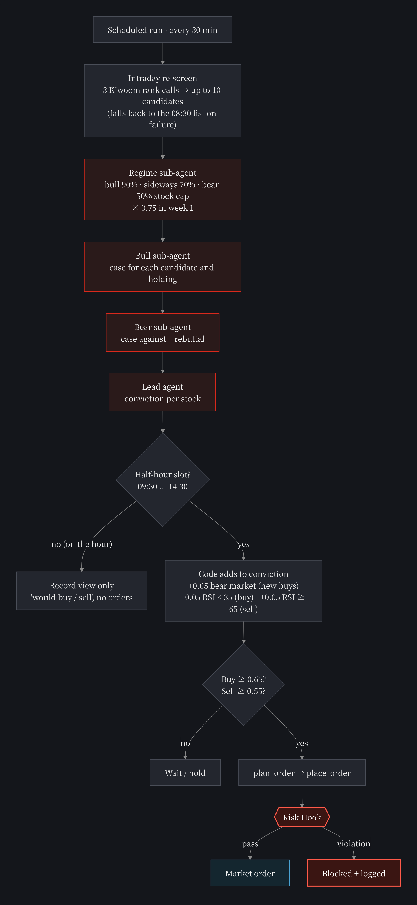
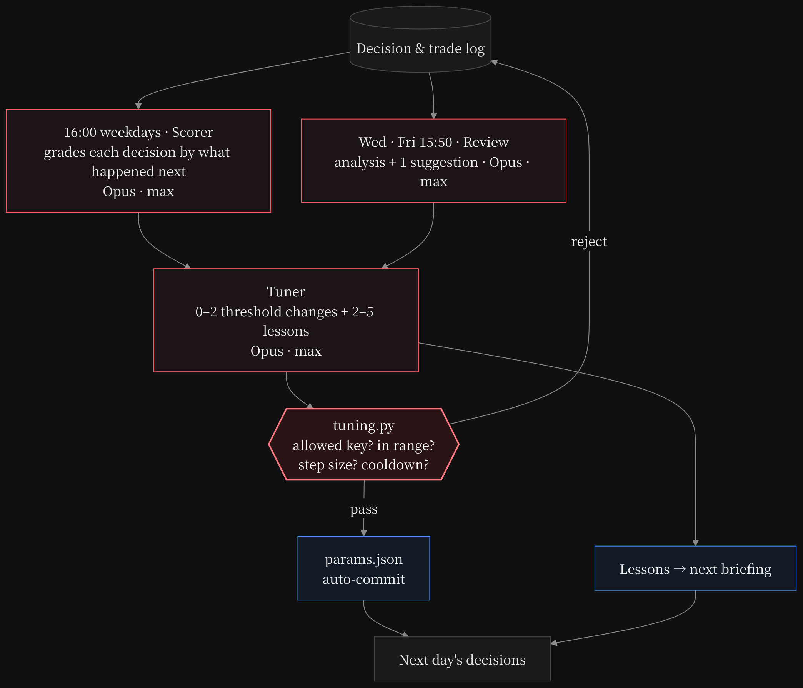
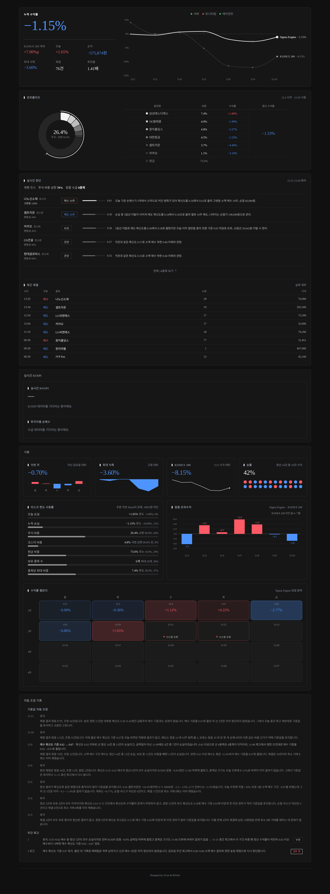

<div align="center">

# UOStock AI Trader

**Claude Code agents argue. Code decides.**

Team *Hynix 298F* · 2026 Navist UOStock AI Auto-Trading Mock Investment Competition (University of Seoul)

[**Live Dashboard →**](https://isopink.github.io/hynix-298f/) · [한국어](README.ko.md)


</div>

---

## At a glance

| | |
|---|---|
| **Competition** | Korean equities mock trading, Nov 2 – 27, 2026 · one team account · ₩50M |
| **Rule** | The AI must make every decision and place every order itself. No manual orders, no human approval of orders |
| **Approach** | Ten role-specific Claude agents gather facts, debate and score conviction. Python sizes the order, a Hook can veto it |
| **Benchmark** | KODEX 200 (vs. the Nov 2 open) |
| **Cadence** | A decision with orders every 15 min (09:30 – 15:15, 24 a day); a stock sold today is not bought back the same day |
| **Result** | 🏁 After the competition (Nov 29, 2026) |

## Why this design

Give an LLM the whole trading loop and two things go wrong:

1. **Hallucinated numbers** — it misreads a price and trades on it.
2. **No hard limits** — "cut losses at −7%" in a prompt is a wish, not a guarantee.

So one rule runs through everything: **agents propose, rules decide.**

- Every number the model sees is computed in Python first.
- Order size is computed in Python, not by the model.
- Risk limits live in a Claude Code Hook that fires before the order tool. The agent cannot skip it or edit it.

## How it works

### The whole loop

<p align="center"></p>

### One decision run

<p align="center"></p>

Sells go first, then buys. Only candidates that changed since the last run go through research and debate; the rest carry their previous call forward. Bull and Bear never search on their own: they argue from the same fact sheet the Research agent builds, and code checks every number they cite against the briefing.

Stop-loss, take-profit and max holding days are checked every minute by a watcher. When one hits, it starts a sell-only agent run. The agent and the Hook still place that order, never the watcher itself.

### Agents (split by role on Nov 12)

| Agent | Job | When | Model · effort |
|---|---|---|---|
| Lead | Combines everything into a final conviction and action; directs the others | every run | Opus 5.5 · xhigh |
| Regime | Index trend (5/20-day MAs) and volatility → bull / sideways / bear | 15-min decision | Opus 5.5 · high |
| Position | Sell / hold / add conviction for holdings; don't dump winners too early | 15-min decision | Opus 5.5 · xhigh |
| Research | Fact sheet for the stocks under debate: news, filings, sector, overseas (no opinions; 6 searches, 8 min cap) | 15-min decision | Opus 5.5 · xhigh |
| Bull / Bear | Argue for and against each candidate from the same fact sheet | 15-min decision | Opus 5.5 · high / xhigh |
| Executor | Works through the decision list: sells, then buys, then records | 15-min decision | Haiku 5.5 |
| Scorer | Grades each past decision by what happened next, groups the causes | weekdays 16:00 | Opus 5.5 · max |
| Tuner | Submits 0–2 threshold changes and 2–5 lessons | weekdays 16:00 | Opus 5.5 · max |
| Review | Weekly analysis, one suggestion | Wed · Fri 15:50 | Opus 5.5 · max |
| Writer | Weekly report draft (outside the trading loop) | Wed · Fri 17:00 | Sonnet 5.5 · medium |

Regime, Position and Research run in parallel. Models are routed by role: everything that shapes conviction runs on Opus (the most consequential calls at xhigh), and the mechanical order work runs on Haiku.

### What code does

| Part | Job |
|---|---|
| Data prep | KRX prices and flows, Naver news → GS Quant indicators → candidate screen (10 KOSPI + 5 KOSDAQ, plus a high-volatility slot) |
| Intraday re-screen | Kiwoom trading-value and foreign/institution net-buy ranks → fresh candidates and live RSI |
| Routing | Debate only what changed: price ±1.5%, flow flipped, new news, new candidate. Everything at the first run and at 09:30, 15:00, 15:15 |
| Claim check | Every number in Bull, Bear and Position must exist in the briefing |
| Sizing | Conviction → 8–12% of equity per stock (4–8% probe buys, ≤ 5% for KOSDAQ and high-vol) → quantity; stop −7%, target +10%, max 5 days |
| Risk check | Claude Code Hook before every `place_order`; any violation blocks the order |
| Watcher | Every minute: stop / target / holding days → sell-only run (no sells before 09:30) |
| Order execution | Own MCP server calling the Kiwoom REST API directly (cleared with the organisers) |

### Risk limits (fixed for the whole competition)

| Rule | Limit |
|---|---|
| Per stock | ≤ 20% of equity |
| Holdings | ≤ 20 stocks |
| Cash | ≥ 10% of equity |
| Per order | ≤ ₩10M · ≤ 8 orders per run |
| Chasing | No buy if the stock is already up ≥ 10% today (≥ 15% for KOSDAQ, the one agreed exception) |
| Daily loss | −3% → no new buys today |
| Total loss | −10% → stock cap halved |
| Exposure | Regime cap × week factor |

The agent cannot change these. The tuner only touches decision thresholds, and only inside ranges set in [`agent/config/tuning.json`](agent/config/tuning.json).

### Self-tuning, with guardrails

<p align="center"></p>

Grading and tuning are done by different agents, so the tuner never grades its own work. Every change, rejection and lesson shows up on the dashboard.

<sub>Diagram sources: [`assets/diagrams/*.mmd`](assets/diagrams) → `node assets/diagrams/render.js` or `mmdc`</sub>

## Daily schedule (weekdays, KST)

| Time | Run | LLM |
|---|---|---|
| 08:25 → | Balance snapshot every minute → Supabase | – |
| 08:30 | `prep` — account, KRX data, news → briefing | – |
| 08:30 – 15:20 | `monitor` — stop / target / holding days every minute | only when hit |
| **09:30 – 15:15, every 15 min** | `decide` — re-screen → routing → debate → **orders** (24 a day) | ✓ |
| 15:45 | `close` — record today's equity and KODEX 200 | – |
| Wed · Fri 15:50 | `review` — weekly review and suggestion | ✓ |
| 16:00 | `tune` — scorer → tuner | ✓ |
| Wed · Fri 17:00 | `report` — weekly report draft | ✓ |
| always | `sync` — pulls pushed code every minute, restarts loops whose code changed, sends a heartbeat | – |

The agent runs on an always-on desktop and is edited from a laptop. A push reaches the desktop within a minute.

## Dashboard

One page that shows what the agent traded, and why. Korean market colours (gains and buys red, losses and sells blue), flat and motionless, Korean labels.

<table>
<tr>
<td width="68%"></td>
<td></td>
</tr>
<tr>
<td align="center"><sub>Desktop</sub></td>
<td align="center"><sub>Phone</sub></td>
</tr>
</table>

| Section | What's in it |
|---|---|
| **Cumulative return** | Return vs. KODEX 200 since the start, six key numbers (excess return, today, P&L, max drawdown, fills, turnover), status dots (server, monitor, agent), live KOSPI |
| **Portfolio** | Equity weight vs. regime cap, holdings by weight with net-of-fee returns |
| **Live decision** | Latest run: regime, stock cap, each stock's action, conviction and reasoning, recent fills |
| **Record** | This week, max drawdown, win rate, risk-limit usage, daily excess return, return calendar (incident days marked) |
| **Tuning log** | Daily threshold changes and lessons, weekly review suggestions |

**Server dot** — the desktop sends a heartbeat to Supabase every minute; after 3 minutes of silence it turns red (added after the PC went off mid-session on Nov 11).

**Data paths** — Kiwoom keys live only in a `.env` on the desktop. The site reads two sources: JSON the agent pushes to `docs/data/`, and Supabase. In Supabase, balance snapshots arrive through a secret-checked RPC, and `pg_cron` collects KOSPI 1-minute bars (Naver) and investor flows (Daum). Visitors are read-only.

## Tech stack

| Area | Tools |
|---|---|
| Agents | Claude Code — headless runs, sub-agents (per-role model and effort, parallel), PreToolUse Hook, MCP server, tool allow-list (no Bash / Edit / Write) |
| Models | Claude Opus 5.5 · Sonnet 5.5 · Haiku 5.5 |
| Broker | Kiwoom REST API — balance `kt00018`, quote `ka10001`, ranks `ka10032` · `ka10065`, orders `kt10000` · `kt10001` |
| Market data | KRX Data Marketplace (pykrx), NAVER API HUB news search, Naver / Daum Finance via Supabase |
| Indicators | GS Quant — moving averages, RSI, volatility, max drawdown |
| Dashboard | Plain HTML · CSS · D3.js v7, no build step, GitHub Pages |
| Realtime | Supabase — PostgreSQL, RLS, RPC, `pg_cron`, `pg_net` |
| Scheduling | Windows Task Scheduler |

## Repository layout

```
hynix-298f/
├── agent/                  # Trading agent → agent/README.md
│   ├── CLAUDE.md           # Lead agent instructions
│   ├── .claude/            # 9 sub-agents (regime · position · research · bull · bear · executor ·
│   │                       #   scorer · tuner · review · writer), risk Hook, permissions
│   ├── config/             # risk_limits.json (fixed) · params.json (tuned) · tuning.json (tuning rules)
│   ├── src/                # data_prep · intraday · routing · sizing · risk · broker · mcp_server
│   │                       # monitor · tuning · logger · benchmark · sync
│   ├── tests/test_rules.py
│   ├── run.py              # prep / decide / exit / close / tune / review / report / monitor / sync
│   └── setup_tasks.ps1     # Task Scheduler registration
├── docs/                   # Dashboard (GitHub Pages)
│   ├── index.html          # Single file
│   ├── config.js           # Supabase URL + public anon key
│   └── data/               # JSON the agent publishes after each run
├── live/snapshot.py        # Kiwoom balance + KOSPI → Supabase, every minute
├── supabase/               # schema.sql · kospi.sql · flow.sql · heartbeat.sql · shadow.sql
├── reports/                # Plan, weekly and final reports
└── assets/                 # README images
```

## Running it

Deployment guide: [`docs/DEPLOY.md`](docs/DEPLOY.md) · agent setup: [`agent/README.md`](agent/README.md) (both partly Korean).

```bash
# Dashboard locally
cd docs && python -m http.server 8000          # → http://localhost:8000

# Balance connection (after filling live/.env)
cd live && python snapshot.py --dry

# Agent, one run (MODE=mock in agent/.env trades a virtual account)
cd agent
.venv\Scripts\python tests\test_rules.py
.venv\Scripts\python run.py prep
.venv\Scripts\python run.py decide
```

## Experiment: ontology shadow engine (SiON)

From Nov 9 to 12 an ontology-based variant ([sigma-six-ontology](https://github.com/kyaa468-ui/sigma-six-ontology), branch `shadow/ontology`) ran next to Sigma on a virtual account, deciding at the same times. Its decision tracing was thorough, but it used about 3.5× the tokens, its learning records (premises, cases, lessons) barely grew, and its log file grew large enough to exhaust the desktop's memory. It was paused on Nov 12 to revisit after the competition; its records and branch are kept.

## Results & retrospective

> 🏁 After the competition (Nov 29, 2026)
>
> - Final return, excess return over KODEX 200, turnover
> - Did conviction predict returns?
> - What the risk Hook blocked, and what that cost or saved
> - What self-tuning changed, and whether it helped
> - What I'd do differently

## Acknowledgements

| Repository | What I borrowed |
|---|---|
| [BijectiveLabs/bitra](https://github.com/BijectiveLabs/bitra) | "Agents propose, the system decides"; logging decisions and rejections |
| [fidetolabs/qanat](https://github.com/fidetolabs/qanat) | Agents querying stock screens through MCP |
| [Kiwoom-Securities/Kiwoom-REST-API](https://github.com/Kiwoom-Securities/Kiwoom-REST-API) | Quotes, balance, ranks and mock orders |
| [goldmansachs/gs-quant](https://github.com/goldmansachs/gs-quant) | Indicator computation |

## Team

**Hynix 298F** — Seokmin Lee · Munhwa Park

[](https://www.instagram.com/sl2eee/)

---

<div align="center">
<sub>Designed by S.Lee &amp; M.Park · Built for a mock-trading competition. Not investment advice.</sub>
</div>
